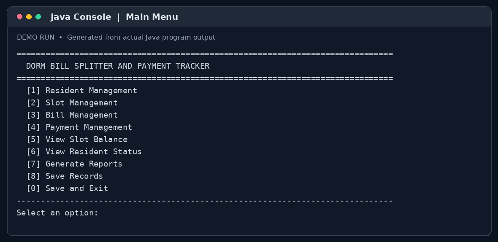
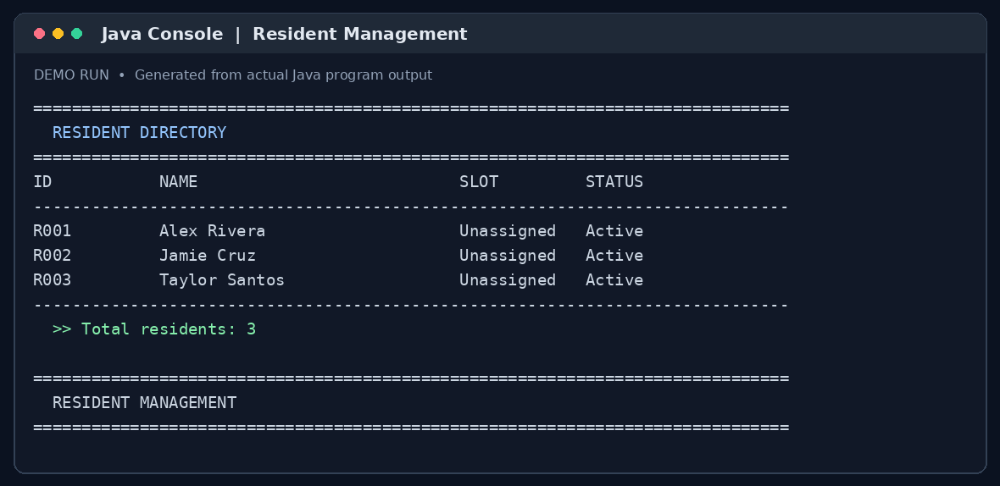
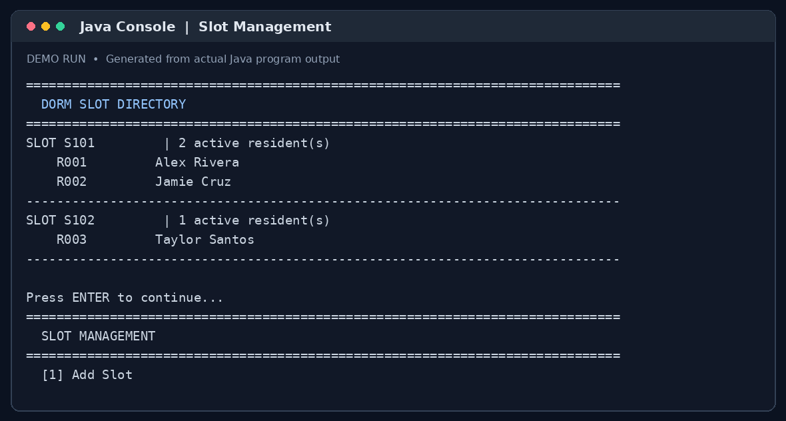
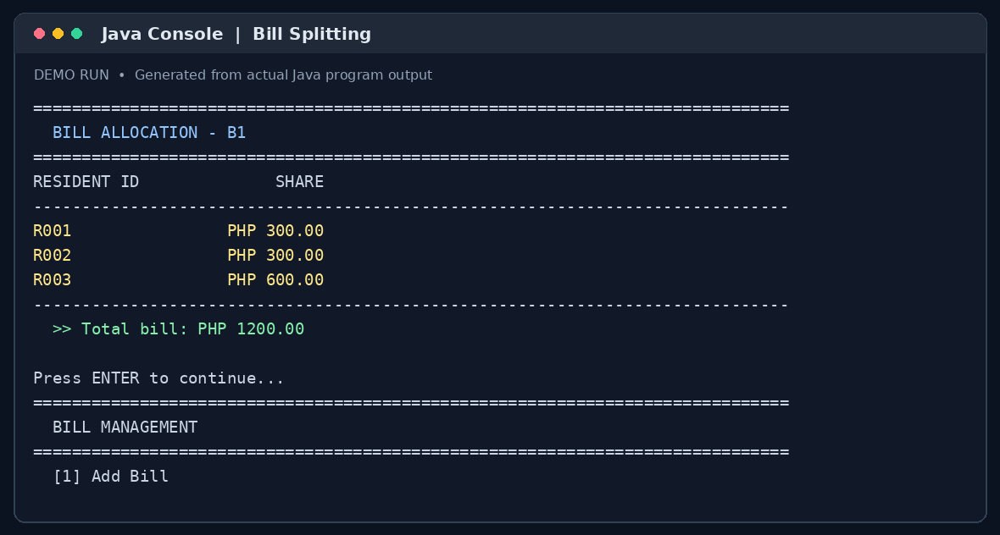
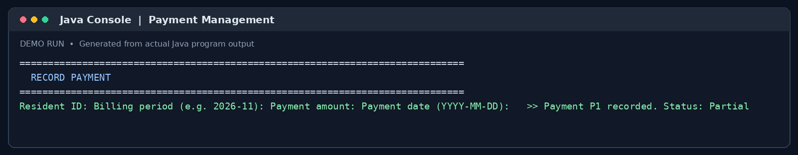
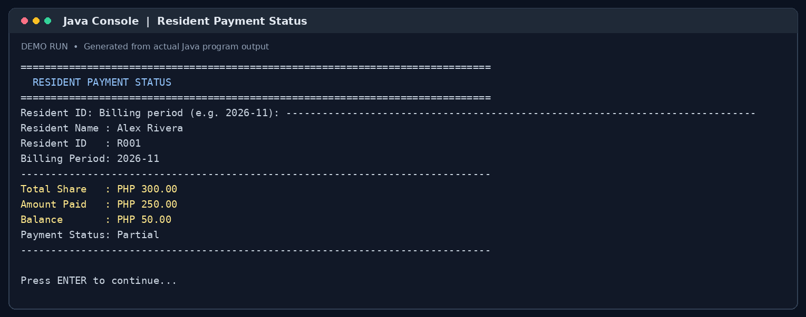
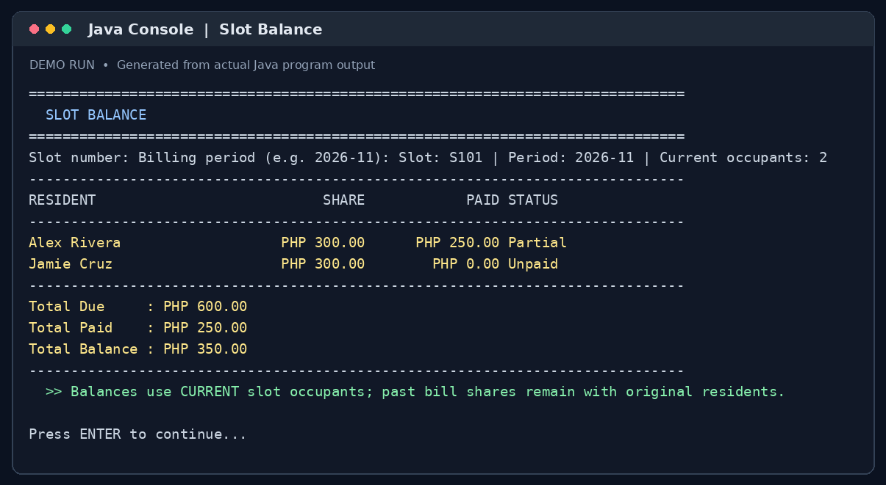
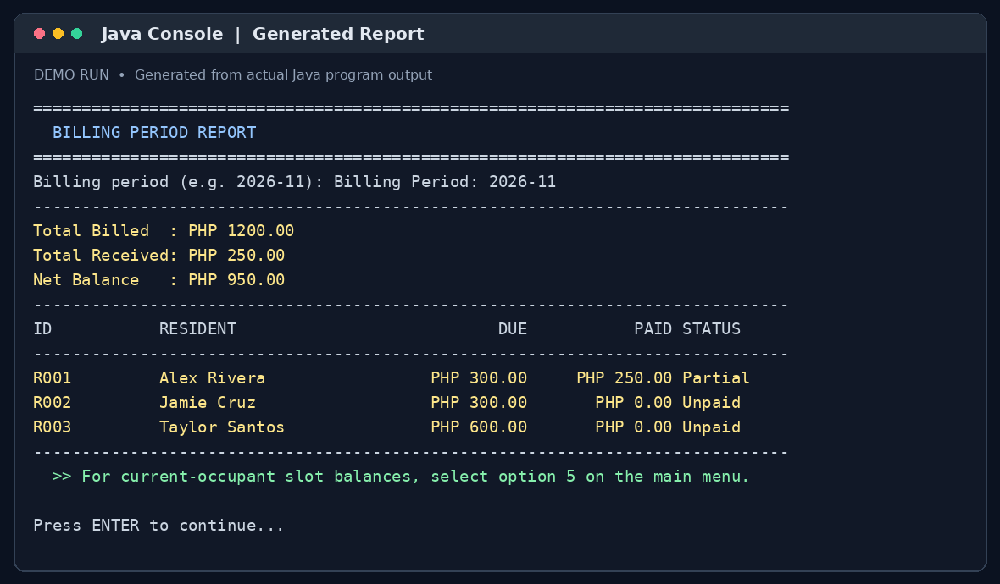

# Dorm Bill Splitter and Payment Tracker

## Project description
A Java console application for managing dormitory residents, slot assignments, shared bills, individual payments, and balances.

## Problem being addressed
Manual splitting of dorm bills and tracking partial payments can lead to incorrect balances and confusion.

## Project objectives
- Manage resident and slot records.
- Split each bill equally across occupied slots, then across occupants within each slot.
- Record payments and report balances by resident and billing period.
- Save and reload records.

## Target users
Dormitory manager and residents (manager-operated console interface).

## Main features
Resident management; slot management; bill management; payment management; slot balance; resident status; billing-period reports; file persistence.

## Technologies used
Java 17+, standard Java library, console interface, Java object serialization.

## Team members and roles
- Calingasan, Yael John P. — Lead Programmer
- Malubago, John Dominic M. — Team Leader
- Montalbo, Alexander John P. — Documentation 
- Mortel, Paul Adrian M. — Design Programmer

## OOP concepts demonstrated
Classes/objects (`Resident`, `Slot`, `Bill`, `Payment`); encapsulation (private fields and methods); abstraction (`Transaction`); inheritance (`Bill` and `Payment` extend `Transaction`); polymorphism (`description()`); exception handling; Java collections.

## How to run
Open a terminal in the project root:

```bash
javac -d out src/*.java
java -cp out Main
```

On Windows PowerShell the same commands work. The program creates `dorm_records.dat` in the directory where it is launched.

## Sample screenshots

### 1. Main Menu


### 2. Resident Management


### 3. Slot Management


### 4. Bill Allocation


### 5. Payment Management


### 6. Resident Payment Status


### 7. Slot Balance


### 8. Generated Report

  

## Known limitations
- Console-only, local single-user application.
- No real payment gateway or online synchronization.
- Current slot-balance view uses current occupants; historic bills retain original resident allocations.
- The new separate-class serialization format is not compatible with existing `.dat` files created by the original single-file version. Back up old data before switching.

## Future improvements
Historical slot occupancy reports, exportable reports, and a graphical interface.

## Documentation
- [Project Proposal](docs/PROJECT-PROPOSAL.pdf)
- [UML Class Diagram](docs/UML-Diagram.pdf)
